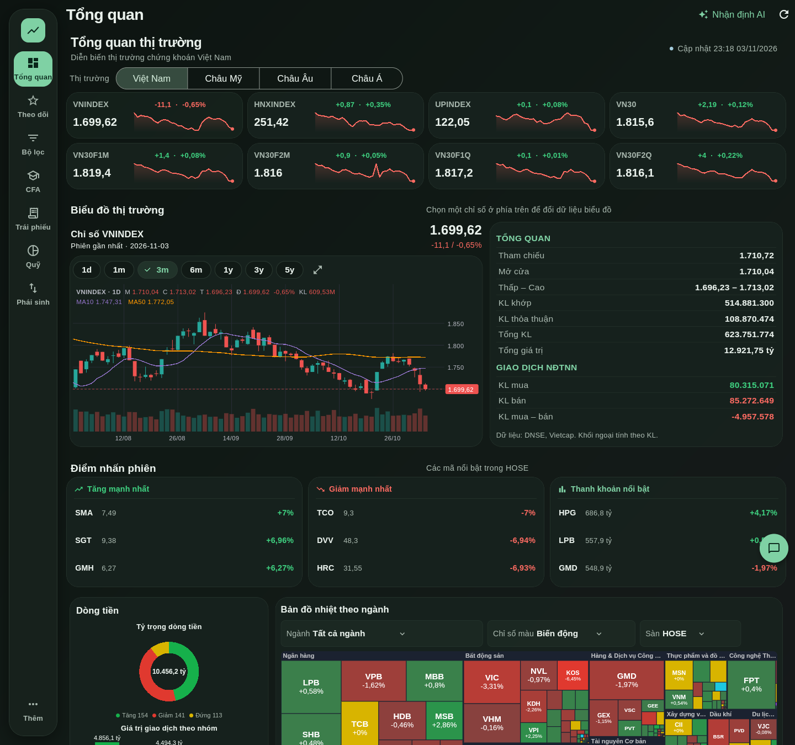
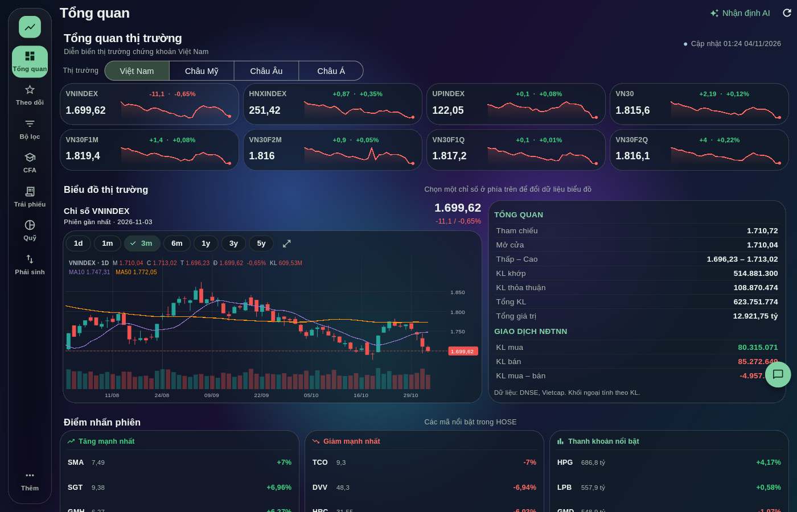
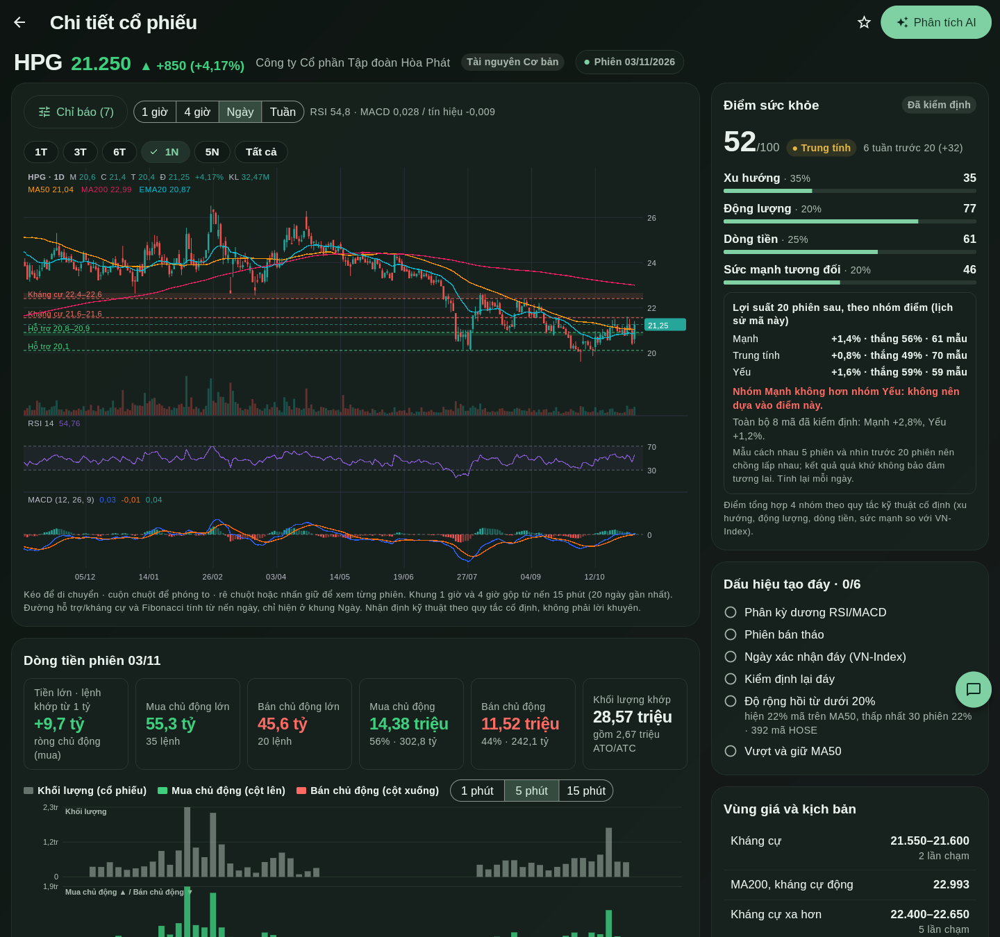
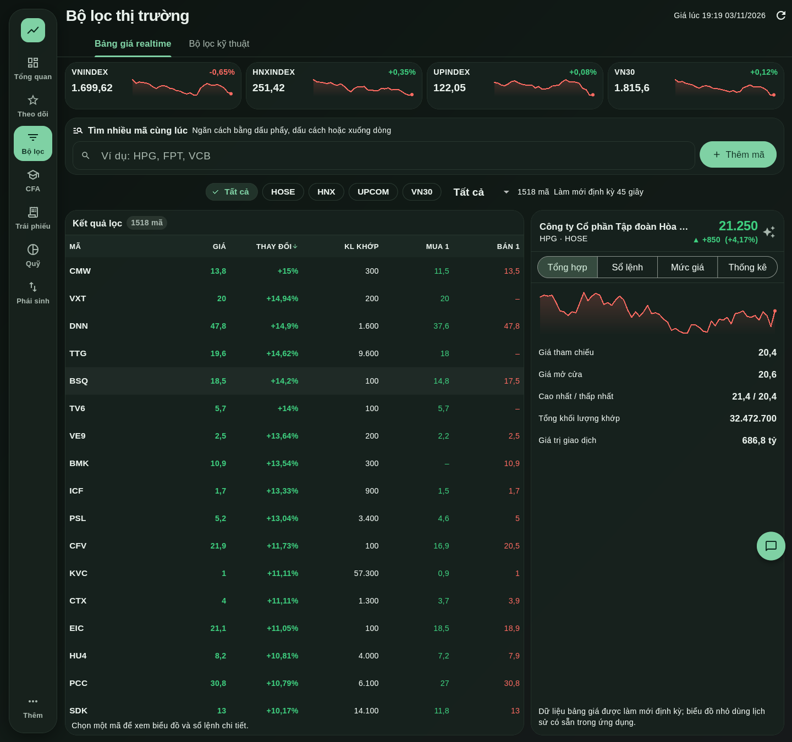
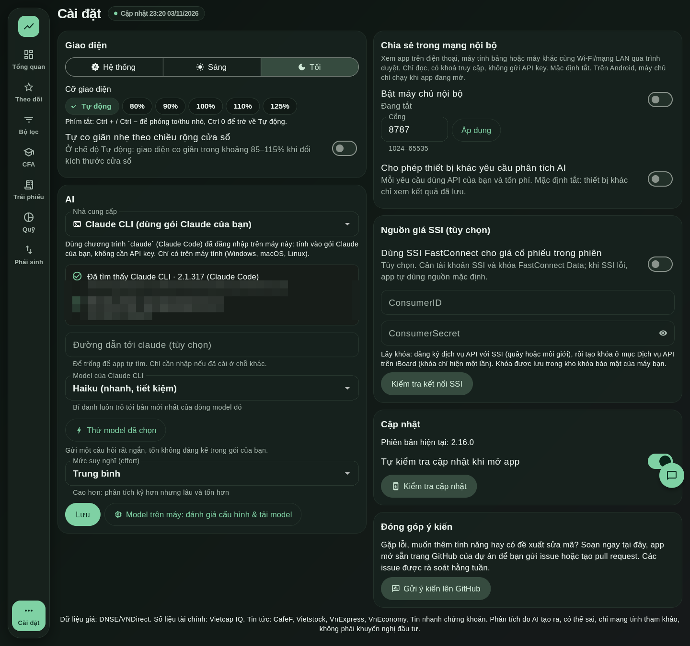
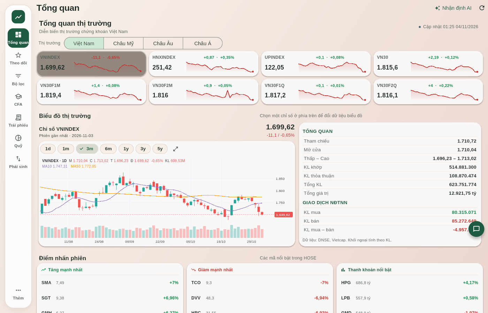
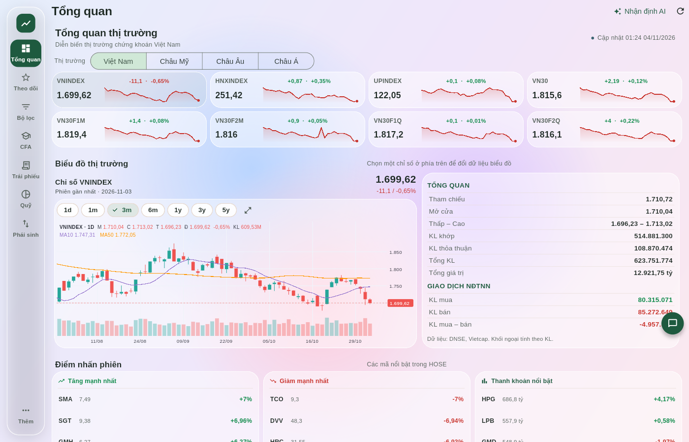
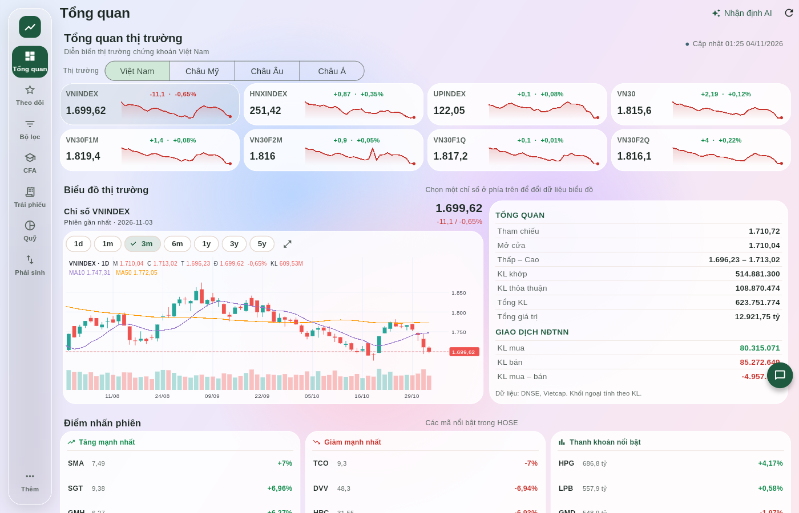

# VN Stock Insight

App phân tích cổ phiếu Việt Nam bằng AI cho **Windows, macOS, Linux và Android**. App tự lấy giá, chỉ báo kỹ thuật, số liệu tài chính và tin tức, rồi dùng AI do bạn chọn để phân tích chuyên sâu. AI có thể chạy qua API hoặc ngay trên máy bạn. Không cần tài khoản, không có máy chủ trung gian: app không gửi dữ liệu nào cho tác giả. Danh mục, kết quả phân tích và API key lưu trên máy bạn; riêng nội dung bạn nhờ AI phân tích sẽ được gửi tới nhà cung cấp AI bạn chọn (xem [Quyền riêng tư](#quyền-riêng-tư)), trừ khi bạn dùng model chạy ngay trên máy.

> Công cụ tham khảo. App **không đặt lệnh**, và phân tích của AI **không phải khuyến nghị đầu tư**.

## Ảnh chụp màn hình

Giao diện **Liquid Glass** (mặc định từ bản 3.0.0) trên Linux, dữ liệu thị trường thật tại thời điểm chụp (chụp trong màn hình ảo, không có thông tin cá nhân).

| Tổng quan thị trường (Liquid Glass, sáng) | Tổng quan (Liquid Glass, tối) |
|---|---|
|  |  |
| **Chi tiết cổ phiếu** | **Bảng giá và bộ lọc** |
|  |  |
| **Cài đặt: công tắc kiểu giao diện và thanh trượt Độ blur kính** | **Cổ điển** (gradient kem hồng như các bản trước) |
|  |  |
| **Độ blur kính 0%** (không blur nền, nhẹ nhất) | **Độ blur kính 100%** (mờ và dày nhất) |
|  |  |

## Tính năng

- **Tổng quan:** dashboard thị trường với các chỉ số, biểu đồ, độ rộng thị trường và bản đồ nhiệt có thể xem theo biến động, giao dịch khối ngoại hoặc thanh khoản.
- **Trang chi tiết cổ phiếu và chỉ số:** bấm vào một mã hoặc một chỉ số để mở trang riêng (nhiều cột trên màn hình rộng, xếp dọc trên điện thoại):
  - biểu đồ giá các khung 1 giờ, 4 giờ, Ngày, Tuần; **một menu Chỉ báo** gom MA10/20/50/200, EMA20, Bollinger, Khối lượng, RSI, MACD, Stochastic, MFI cùng vùng hỗ trợ/kháng cự và Fibonacci;
  - **Điểm sức khỏe** 0–100 gồm 4 nhóm (xu hướng, động lượng, dòng tiền, sức mạnh tương đối), kèm **kiểm định lịch sử ngay trong app**: chạy lại điểm trên giá quá khứ rồi so lợi suất 20 phiên sau của nhóm Mạnh, Trung tính, Yếu. Kết quả lưu theo ngày (mỗi ngày tính lại một lần), ưu tiên mã trong danh sách theo dõi rồi mã đang xem, có nhãn *Đang kiểm định*. Kết quả có thể cho thấy điểm **không** có giá trị dự báo; app hiển thị đúng như vậy;
  - **Dấu hiệu tạo đáy** (6 dấu hiệu, gồm độ rộng thị trường tính từ giá cả sàn HOSE: tỷ lệ mã trên MA50 và việc hồi từ dưới 20%), **vùng giá và kịch bản** theo ngưỡng;
  - **Dòng tiền trong phiên** từ lệnh khớp: khối lượng, mua chủ động, bán chủ động theo 1/5/15 phút, "tiền lớn" (lệnh từ 1 tỷ đồng), và biểu đồ thanh khoản trong phiên so với phiên trước.
- **Theo dõi:** tra cứu mã bất kỳ (HOSE, HNX, UPCoM), thêm hoặc gỡ mã khỏi danh sách theo dõi, phân tích chuyên sâu từng mã:
  - luận điểm đầu tư và điều kiện làm luận điểm sai;
  - kết quả kinh doanh 8 quý; với ngân hàng thì xem NIM, nợ xấu, CASA;
  - định giá so với lịch sử, vị thế cạnh tranh;
  - kỹ thuật (MA, RSI, MACD, Bollinger, Stochastic, ATR, khối lượng);
  - lịch sự kiện sắp tới, 3 kịch bản, bảng chấm điểm 8 tiêu chí, khuyến nghị của các công ty chứng khoán;
  - các phân tích bổ sung theo yêu cầu: ngành, so sánh cùng ngành, dòng tiền, vĩ mô, tin tức, rủi ro;
  - xuất báo cáo ra PDF.
- **CFA:** phân tích theo khung CFA với chỉ số định lượng (Sharpe, Beta, drawdown…), định giá và kịch bản; lưu báo cáo trên máy; **Danh mục** quản lý nhiều danh mục đầu tư và phân tích danh mục theo khung CFA.
- **Bộ lọc:** bảng giá realtime, tìm nhiều mã cùng lúc, bảng kỹ thuật VN30 sắp xếp được, có điểm kỹ thuật tổng hợp.
- **Vĩ mô:** dữ liệu vĩ mô theo nhóm, kèm tab lãi suất (lợi suất trái phiếu Chính phủ, lãi suất tiền gửi).
- **Tin tức:** tin 48 giờ từ CafeF, Vietstock, VnExpress, VnEconomy, Tin nhanh chứng khoán, gắn mã liên quan.
- **Nguồn giá SSI (tùy chọn):** dùng SSI FastConnect cho giá trong phiên nếu bạn có khóa; lỗi thì tự dùng nguồn mặc định.
- **Giao diện:** **Liquid Glass** (mặc định): bề mặt kính trong mờ với viền sáng mảnh, highlight nhẹ, bóng mềm, thanh icon dọc nổi bên trái và thanh điều hướng dưới dạng kính trên điện thoại, nút dạng viên thuốc, bo góc lớn. Trong Cài đặt đổi qua lại **Liquid Glass / Cổ điển** (gradient kem hồng/xanh rêu như các bản trước) có hiệu lực ngay, không cần khởi động lại. Thanh trượt **Độ blur kính** (0–100%, mặc định 60%) chỉnh đồng thời độ mờ nền và độ đục của kính theo thời gian thực; chữ luôn đạt tương phản ≥ 4,5:1 ở mọi mức (có test quét), ở 0% tắt hẳn blur nền để nhẹ nhất. Sáng/tối hoặc theo hệ thống; khi hệ thống bật giảm chuyển động hoặc tương phản cao thì blur giảm theo. Đổi tab theo kiểu kính lỏng của iOS/macOS mới: ô chọn là một **thấu kính kính** trượt giữa các tab bằng lò xo, giãn theo hướng di chuyển rồi co lại, nổi lên và phóng nhẹ nền phía sau khi bấm, kéo ngang để chọn tab dưới ngón tay; nội dung mới hiện ra mờ rồi nét dần. Áp dụng cho thanh icon bên trái và các thanh tab (CFA, Trái phiếu, Quỹ, Vĩ mô, Bộ lọc); tắt hẳn khi hệ thống bật giảm chuyển động và ở kiểu Cổ điển.
- **Hiệu năng:** giải mã bảng giá, kiểm định lịch sử và độ rộng thị trường chạy ở luồng riêng (Isolate) nên giao diện không bị đứng; trang bị che tạm dừng hoạt ảnh và bộ hẹn giờ làm mới; ảnh tin giải mã ở kích thước nhỏ.
- **Cài đặt** dàn hai cột phủ hết chiều ngang cửa sổ trên màn hình rộng.
- **Đóng góp ý kiến:** trong Cài đặt có khung soạn báo lỗi, góp ý tính năng hoặc đề xuất sửa mã (pull request). App mở trang GitHub đã điền sẵn để bạn xem lại và gửi bằng tài khoản GitHub của mình (app không giữ khóa GitHub). Issue được rà soát hằng tuần.
- **Kiểm tra và cập nhật tự động** từ GitHub Releases (xem [Cập nhật tự động](#cập-nhật-tự-động)).

Khung phân tích được chuyển thể từ các plugin **equity-research** và **financial-analysis** của Anthropic ([anthropics/financial-services](https://github.com/anthropics/financial-services), Apache-2.0). Xem [`lib/ai/prompts.dart`](lib/ai/prompts.dart).

## Nhà cung cấp AI

| Loại | Nhà cung cấp |
|---|---|
| Qua API | Claude (Anthropic), OpenAI, Google Gemini, OpenRouter, Groq, Mistral, DeepSeek, xAI Grok, Together AI |
| Chạy trên máy | LM Studio, Ollama |
| Claude CLI (máy tính) | Dùng gói đăng ký Claude có sẵn qua lệnh `claude`, không cần API key |
| Tùy chỉnh | Mọi dịch vụ có API tương thích OpenAI (llama.cpp server, vLLM, Azure…) |

Cấu hình trong **Cài đặt → AI**: chọn nhà cung cấp, nhập API key (lưu trong kho bảo mật của hệ điều hành), rồi bấm **Tải danh sách** để chọn model.

### Claude CLI

Trên Windows, macOS và Linux, chọn **Claude CLI** trong **Cài đặt → AI** để dùng tài khoản Claude (Pro/Max) qua lệnh `claude` thay vì API key. Mọi tính năng AI (phân tích mã, bản tin thị trường, chat, CFA) đều chạy qua lựa chọn này.

- **Chọn model:** Mặc định của CLI, Fable, Opus, Sonnet, Haiku (luôn là bản mới nhất), hoặc nhập tên model đầy đủ như `claude-opus-5-5`. Mức suy luận chọn cùng chỗ. Nút **Thử model đã chọn** gửi một câu hỏi nhỏ để kiểm tra.
- **Chưa cài:** bấm **Cài Claude CLI**. App hiện hộp xác nhận cùng lệnh tương đương, rồi tải script chính thức từ `claude.ai` (từ chối nếu bị chuyển hướng sang tên miền khác), chạy và hiển thị nhật ký. Cũng có cách cài bằng npm nếu máy có sẵn. Chưa đăng nhập thì bấm **Đăng nhập tài khoản Claude**.
- **Cách gọi:** chạy `claude -p` ở thư mục tạm, tắt toàn bộ công cụ và không nạp cấu hình/dự án nào, nên Claude chỉ nhận văn bản app gửi. Tìm `claude` trong PATH, các thư mục cài thường gặp và shell đăng nhập (mise, nvm…), hoặc dùng đường dẫn bạn nhập.
- **Lưu ý:** phân tích dùng hạn mức của gói đăng ký. Chỉ có trên Windows, macOS và Linux (Android không có).

### Model trên máy

**Cài đặt → Model trên máy** đánh giá cấu hình máy bạn (RAM, CPU, GPU/VRAM, Apple Silicon) và đề xuất model phù hợp. Mỗi model được gắn nhãn *Chạy tốt*, *Chạy được nhưng chậm*, hoặc *Không đủ bộ nhớ*.

- Nếu dùng Ollama, bạn tải model ngay trong app bằng một nút bấm, có thanh tiến độ.
- Nếu dùng LM Studio, app chép tên model để bạn tìm trong mục Discover.
- Danh sách đề xuất nằm ở [`assets/models.json`](assets/models.json). App đọc bản mới nhất từ GitHub, nên sửa file này là cập nhật được danh sách cho mọi người dùng.
- Trên Android, bạn trỏ địa chỉ tới Ollama/LM Studio đang chạy trên máy tính trong cùng mạng Wi-Fi, ví dụ `http://192.168.1.10:11434/v1`.

## Cài đặt

Tải bản mới nhất tại [Releases](https://github.com/ngiangbao/vn-stock-insight/releases):

- **Windows:** `…-windows-x64-setup.exe`, mở trình cài đặt và làm theo hướng dẫn (cài cho riêng người dùng, không cần quyền quản trị). Cũng có `…-windows-x64-portable.zip` để giải nén và chạy thẳng `vn_stock_insight.exe`. Xem thêm mục [Cảnh báo SmartScreen và diệt virus](#cảnh-báo-smartscreen-và-diệt-virus-trên-windows).
- **macOS:** `…-macos.pkg`, mở gói cài đặt để cài vào Applications. Gói chưa được ký/notarize bằng Apple Developer ID; macOS có thể yêu cầu xác nhận khi mở. File `…-macos.zip` dùng cho cập nhật tự động trong app.
- **Linux:** `…-linux-x64.tar.gz`, giải nén rồi chạy `./vn-stock-insight/install.sh`. Gỡ bằng `install.sh --uninstall`.
- **Android:** `….apk`, mở file để cài.

### Cập nhật tự động

Chỉ cần cài một lần. Khi có bản mới, app báo trong hộp thoại; bấm **Cập nhật ngay** để app tự tải, kiểm tra SHA-256 theo `SHA256SUMS.txt` của cùng bản phát hành, cài bản mới và mở lại (Windows chạy bộ cài ngầm, macOS và Linux thay đúng thư mục ứng dụng đang chạy). Dữ liệu và cài đặt của bạn được giữ nguyên. Nếu máy không cập nhật tự động được (ví dụ thư mục cài đặt không ghi được), hộp thoại vẫn có nút tải thủ công. Android cập nhật bằng cách tải file `.apk` mới.

### Cảnh báo SmartScreen và diệt virus trên Windows

App chưa được ký số (đang chuẩn bị xin chứng chỉ miễn phí của SignPath Foundation, xem [Chính sách ký số](#chính-sách-ký-số)), nên Windows SmartScreen hiện "Windows protected your PC" và một số phần mềm diệt virus có thể chặn file mới, ít người tải. Đây là cảnh báo về file chưa có uy tín, không phải kết quả phát hiện mã độc. Cách cài an toàn:

1. Tải file từ trang Releases của repo này và đối chiếu SHA-256 với `SHA256SUMS.txt` đính kèm (PowerShell: `Get-FileHash .\tên-file`).
2. Khi SmartScreen hiện cảnh báo: chọn **More info** rồi **Run anyway**. Với file đã tải: chuột phải file, **Properties**, tick **Unblock**, **OK** rồi mở lại.
3. Nếu phần mềm diệt virus chặn, thêm thư mục `%LOCALAPPDATA%\Programs\VN Stock Insight` (hoặc thư mục giải nén bản portable) vào danh sách loại trừ, hoặc gửi file cho nhà cung cấp để báo nhận diện nhầm. Windows Defender: <https://www.microsoft.com/wdsi/filesubmission>.

Mã nguồn đầy đủ nằm trong repo, bạn có thể tự build bằng `flutter build windows --release`.

## Chính sách ký số

Các bản phát hành Windows được ký số: *Free code signing provided by [SignPath.io](https://signpath.io), certificate by [SignPath Foundation](https://signpath.org).* Trạng thái: đang chuẩn bị hồ sơ; đến khi được cấp chứng chỉ, các file Windows trên Releases có thể chưa được ký (xem [docs/CODE_SIGNING.md](docs/CODE_SIGNING.md)).

- Vai trò: người viết mã và duyệt thay đổi (committer, reviewer) và người duyệt ký (approver) hiện là chủ dự án, [@ngiangbao](https://github.com/ngiangbao).
- Chỉ ký file do GitHub Actions của repo này build từ mã nguồn công khai ở đây; không ký file của bên thứ ba.
- Tài khoản có quyền phát hành bật xác thực hai lớp.

## Quyền riêng tư

Tác giả không vận hành máy chủ, không có tài khoản và không thu thập dữ liệu sử dụng: app không gửi thông tin nào cho tác giả. App chỉ kết nối mạng để thực hiện chức năng bạn dùng:

- **Dữ liệu thị trường và tin tức:** DNSE, VNDirect, Vietcap, SSI (nếu bạn bật), Yahoo, World Bank, IMF, TradingEconomics qua TradingView, CafeF và các RSS báo chí. Các nguồn này nhận địa chỉ IP và mã cổ phiếu bạn xem.
- **Cập nhật và đóng góp ý kiến:** kiểm tra và tải bản mới từ GitHub; mở trang GitHub khi bạn chủ động gửi issue (nội dung đăng công khai, app không giữ khóa GitHub).
- **Nhà cung cấp AI do bạn chọn:** khi bạn bấm phân tích hoặc hỏi chat, app gửi trực tiếp từ máy bạn tới nhà cung cấp đó (Anthropic, OpenAI, Google, OpenRouter, Groq, Mistral, DeepSeek, xAI, Together, hoặc Claude CLI qua tài khoản Claude của bạn) các thông tin sau: mã cổ phiếu và số liệu giá, chỉ báo, số liệu tài chính, tiêu đề và tóm tắt tin tức liên quan; với phân tích danh mục thì thêm các mã, số lượng, giá vốn, mục tiêu đầu tư, khung thời gian và mức chấp nhận rủi ro bạn nhập; với chat thì thêm câu hỏi và tối đa sáu lượt hội thoại gần nhất. Dữ liệu được nhà cung cấp xử lý theo chính sách của họ (có thể nằm ở nước ngoài); tác giả không nhận và không lưu bản sao. App hỏi bạn xác nhận một lần cho từng nhà cung cấp đám mây trước khi gửi, và bạn thu hồi được trong **Cài đặt → Quyền riêng tư**.
- **Không muốn gửi dữ liệu ra ngoài:** dùng model chạy trên máy (LM Studio, Ollama; xem [Model trên máy](#model-trên-máy)); khi đó nội dung không rời khỏi máy bạn.

Khóa API được lưu trong kho khóa bảo mật của hệ điều hành. Nếu máy không có kho khóa, mặc định app chỉ giữ khóa trong phiên làm việc và không ghi ra đĩa; bạn có thể chủ động cho phép lưu không mã hóa trong Cài đặt. Danh mục đầu tư, mục tiêu đầu tư và kết quả phân tích lưu trên máy bạn; hãy cân nhắc trước khi nhập thông tin có thể nhận diện được bạn vào ô tự do hoặc câu hỏi chat.

Chia sẻ trong mạng nội bộ (mặc định tắt) dùng HTTP, bảo vệ bằng token ngẫu nhiên; chỉ bật trong mạng bạn tin tưởng.

## Phát triển

```bash
flutter pub get
flutter run -d linux        # hoặc windows, macos, hoặc thiết bị Android
flutter test
```

Phát hành bản mới:

1. Tăng `version` trong `pubspec.yaml`.
2. Tạo tag trùng tên, ví dụ `git tag v1.0.1 && git push origin v1.0.1`.
3. GitHub Actions sẽ build cả 4 nền tảng và tạo Release. App đang chạy sẽ thấy bản mới khi kiểm tra cập nhật.

Muốn APK được ký ổn định (để cài bản mới đè lên bản cũ), thêm các secrets `ANDROID_KEYSTORE_BASE64`, `ANDROID_KEYSTORE_PASSWORD`, `ANDROID_KEY_ALIAS`, `ANDROID_KEY_PASSWORD`.

## Nguồn dữ liệu

Giá: DNSE (dự phòng VNDirect; SSI nếu bạn bật). Lệnh khớp trong phiên: Vietcap. Số liệu tài chính: Vietcap IQ. Tin tức: RSS của các báo nói trên. Đây là các API công khai không chính thức, có thể thay đổi bất cứ lúc nào. App chỉ phục vụ mục đích cá nhân.

Bản web cũ (GitHub Pages + Supabase) được lưu ở tag [`web-v1`](https://github.com/ngiangbao/vn-stock-insight/tree/web-v1).

## Thị trường mở rộng

- **Trái phiếu:** danh mục trái phiếu doanh nghiệp tự động từ API công khai VNDirect, tải toàn bộ các trang của nguồn, tìm theo mã/ISIN/tổ chức phát hành, lọc ngày đáo hạn và xem điều khoản. Bộ đệm 6 giờ, giữ bản cũ khi lỗi hoặc tải thiếu trang. Nguồn không bao phủ toàn thị trường (khi kiểm tra trả 209 bản ghi, lọc còn 202 mã doanh nghiệp); danh mục đầy đủ HNX yêu cầu đăng nhập, chưa kết nối tài khoản. Không có giá giao dịch hay số lượng còn lưu hành; thiếu dữ liệu hiển thị “–”, không giả định mã còn dư nợ chỉ vì chưa đáo hạn. Giữ công cụ định giá coupon hằng năm và tra cứu HNX; bỏ tab lợi suất Chính phủ khỏi Trái phiếu (Vĩ mô vẫn có dữ liệu lãi suất).
- **Quỹ:** tìm mã ETF/quỹ niêm yết từ bảng giá Vietcap, tải lịch sử giá từ DNSE/VNDirect; khi không tìm được danh sách thì thử E1VFVN30, FUEVFVND và FUEVN100. Đây không phải danh sách toàn bộ quỹ. Giá theo nghìn đồng/CCQ, không phải NAV. Quỹ mở có sổ NAV nhập thủ công, lưu trên máy theo quỹ/ngày; lưu lại cùng quỹ/ngày sẽ thay bản ghi.
- **Phái sinh:** giá, biến động, khối lượng, biểu đồ các chuỗi kỳ hạn VN30F1M/F2M/F1Q/F2Q từ nguồn hiện có. Basis với VN30 chỉ hiển thị khi cùng ngày dữ liệu. Đây là chuỗi luân chuyển, không phải mã đáo hạn cụ thể. Không có chức năng đặt lệnh.
- **Điều hướng:** desktop/tablet gom Vĩ mô, Tin tức và Cài đặt trong menu **Thêm**, mở khi rê chuột hoặc nhấp; hỗ trợ bàn phím và Escape. Điện thoại dùng **Thêm** ở thanh dưới để mở các mục còn lại, gồm ba trang tài sản mới.

Bảng giá quỹ/phái sinh làm mới mỗi 45 giây khi đang xem trong giờ giao dịch; giữ dữ liệu đã tải khi lần tiếp theo lỗi. Ngày dữ liệu hiển thị theo từng mã; dữ liệu bên ngoài có thể chậm hoặc không tải được.

## Chat AI nổi

Nút chat chỉ có icon, có thể kéo tự do và tự bám cạnh trái/phải gần nhất khi thả. Nút xuất hiện trên mọi trang và cửa sổ chi tiết. Mở nút để hỏi AI đang chọn trong Cài đặt; đóng rồi mở lại giữ cuộc trò chuyện trong phiên, nút xóa xóa ngữ cảnh và bỏ qua kết quả đang chờ. Khởi động lại app không giữ lịch sử chat.

Chat chỉ hỗ trợ tài chính/chứng khoán. Mỗi câu hỏi hợp lệ sử dụng tối đa ba lượt AI: kiểm tra đầu vào, tạo câu trả lời, kiểm tra đầu ra, nên có thể chậm hơn và phát sinh thêm chi phí API. Nếu không kiểm tra được hoặc kết quả không hợp lệ, app không hiển thị câu trả lời sinh ra. Chat không có công cụ, không đọc file/key/cài đặt vào prompt, không đặt lệnh, không tự mở URL và chưa có dữ liệu giá trực tiếp. Lịch sử gửi sang nhà cung cấp AI chỉ gồm tối đa sáu lượt đã được chấp nhận; câu hỏi và nội dung trả lời được coi là dữ liệu không đáng tin.

Bảo vệ gồm kiểm tra mẫu tấn công rõ ràng, giới hạn kích thước, tách system prompt khỏi dữ liệu JSON, kiểm tra phạm vi đầu vào/đầu ra và hiển thị văn bản thuần. Đây là các lớp giảm thiểu, **không phải bảo đảm chống mọi prompt injection**, đặc biệt khi sử dụng model khác nhau. Cần thử thêm với model thực tế trước khi tăng quyền cho chat. Tham khảo [OWASP Prompt Injection Prevention](https://cheatsheetseries.owasp.org/cheatsheets/LLM_Prompt_Injection_Prevention_Cheat_Sheet.html).
